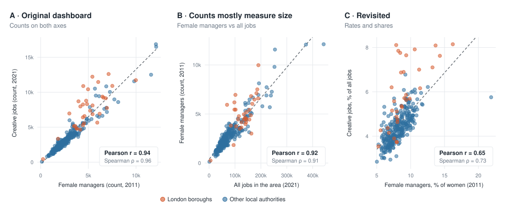
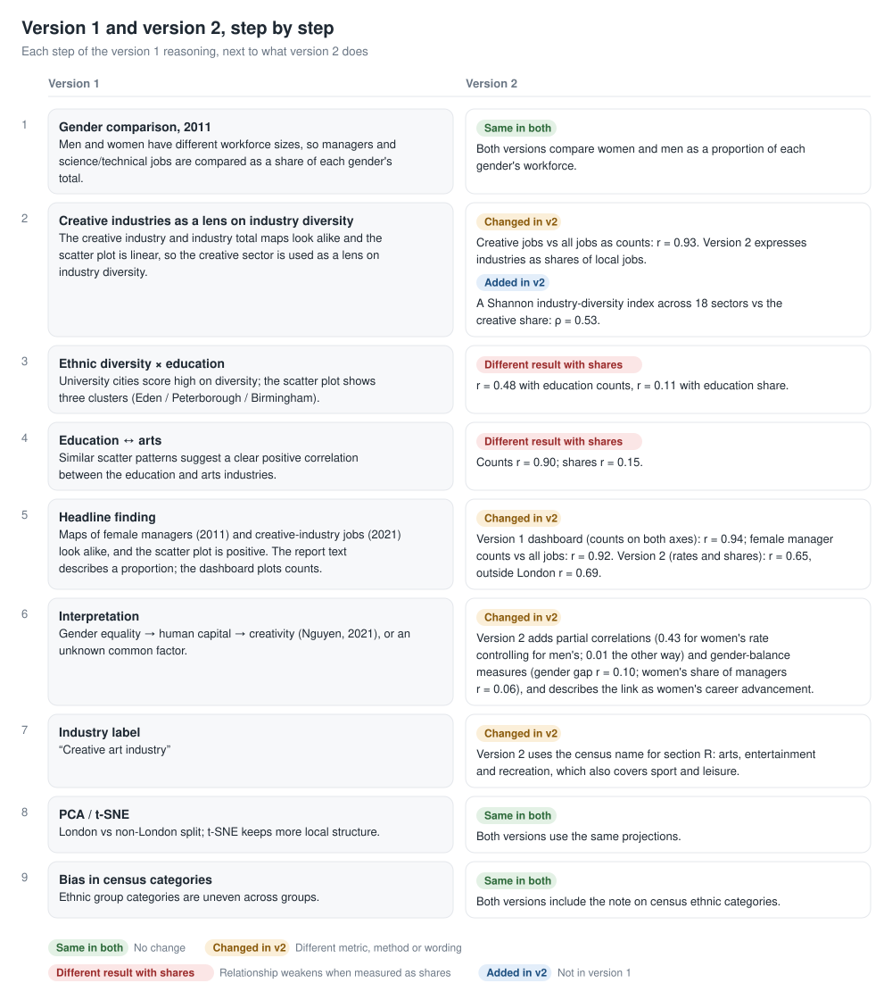

# Women in Management & the Creative Economy

**How do social equality and economic development relate across England & Wales?**
A visual analytics project on 323 local authorities, linking the **2011** and **2021** UK Censuses in Tableau. It has two versions of the analysis and a comparison between them.

## Contents

| Part | What it is |
|---|---|
| [**Version 1 · Original analysis**](v1-original/) | A seven-point Tableau Story on gender equality, ethnic diversity and the creative, education and wider industries. |
| [**Version 2 · Revisited analysis**](v2-revisited/) | The question narrowed to women in management and the creative economy, with every measure expressed as a rate or a share. |
| [**Comparison**](#comparison) | How the two versions differ, and the strengths and limitations of each. Below on this page. |

## Comparison

All figures in this section are printed by [`v2-revisited/scripts/make_charts.py`](v2-revisited/scripts/make_charts.py).

### At a glance

| | Version 1 | Version 2 |
|---|---|---|
| Scope | Gender equality and ethnic diversity vs creative, education and total industry | Women in management vs the creative industries, plus industry structure |
| Women in management (2011) | Number of female managers (headline dashboard) | Female managers as % of employed women |
| Creative economy (2021) | Number of creative-industry jobs | Creative-industry jobs as % of all jobs |
| Headline correlation | r = 0.94 | r = 0.65 (ρ = 0.73; outside London r = 0.69) |
| Related figure | Female manager counts vs all jobs: r = 0.92 | Controlling for men's manager rate: partial r = 0.43 |
| How relationships are assessed | Paired maps compared visually, then scatter and bar charts | Correlation coefficients, partial correlations, a London / non-London check |
| Stated conclusion | Gender equality may play a significant role in fostering economic development; an unknown factor may drive both | Women's career advancement is associated with a larger creative share; measures of gender balance show little relation; correlation only |

### Counts and shares

The same 323 areas, measured two ways:



- **A** is the version 1 headline dashboard, with counts on both axes.
- **B** shows how closely female manager counts follow the total number of jobs.
- **C** is the version 2 headline, with rates and shares.

### Step by step



| Version 1 relationship | With counts | With shares |
|---|---|---|
| Ethnic diversity vs education industry | r = 0.48 | r = 0.11 |
| Education vs arts industries | r = 0.90 | r = 0.15 |
| Creative industry vs industry total | r = 0.93 | — (version 2 uses an industry diversity index: ρ = 0.53) |

### Notes on the version 1 materials

- **Report text and workbook.** The report describes the headline measure as "the proportion of female managers among women". The headline map and scatter plot in the workbook use the number of female managers. A proportion field exists in the workbook but is not used in these views.
- **Eden.** The report describes Eden as having a low female manager proportion. Its rate is 10.4% of employed women, against an average of 8.3%; its count is low because it is a small area.
- **t-SNE sample.** The notebook comment and report describe a random sample of 1,000 rows. The code takes the first 1,000 rows, which with 323 areas is all of them.
- **Boundary changes (both versions).** Eight authorities created by reorganisations between 2011 and 2021 have no 2011 counterpart and are not in the merged data.

### Strengths and limitations

| | Version 1 | Version 2 |
|---|---|---|
| **Strengths** | Broad, literature-grounded question covering two kinds of equality.<br>Complete pipeline from raw census tables to a seven-point Tableau Story.<br>Genders compared as proportions of their own workforce.<br>Reasoned design choices (Simpson's index for maps; bubble charts and treemaps tested and dropped).<br>Reflection on bias in census ethnic categories.<br>Flags its own limitations: raw industry totals and a possible third factor. | Rates and shares in all headline measures, so area size does not drive results.<br>Relationships quantified, with a London / non-London check and partial correlations.<br>Separates women's advancement from gender balance.<br>Every number reproducible with one script.<br>Limitations stated explicitly. |
| **Limitations** | Headline maps and scatter plot use counts, which follow area size.<br>Relationships judged from map similarity without coefficients.<br>Conclusion leans towards a causal reading.<br>"Creative art industry" label covers a broader census section.<br>The points listed under *Notes on the version 1 materials*. | Narrower scope: the ethnic diversity and education themes are not carried forward.<br>Measures chosen after version 1's results were known, so findings are exploratory.<br>Still correlational; neighbouring areas are not independent, so standard tests overstate evidence.<br>Industry structure only; no income or output data.<br>2021 census taken during the pandemic.<br>Tableau Story points 3 and 5 still use counts; findings 3–4 appear only in the README. |

## Repository structure

```
├── README.md          overview and comparison (this page)
├── images/            comparison diagram
├── data/              census extracts and the merged dataset, shared by both versions
├── v1-original/       version 1: README, Tableau workbook, data preparation notebook
└── v2-revisited/      version 2: README, Tableau workbook, chart script and charts
```

## Data

[Office for National Statistics, Census 2011 and Census 2021](https://www.ons.gov.uk/census), local-authority level for England & Wales, used under the [Open Government Licence v3.0](https://www.nationalarchives.gov.uk/doc/open-government-licence/version/3/). UK geocoding in the Tableau workbooks is from The Information Lab.

| Folder / file | Contents |
|---|---|
| `data/2011_industry_by_sex/`, `data/2011_occupation_by_sex/` | 2011 industry and occupation, total and by sex |
| `data/2021_industry/`, `data/2021_occupation/`, `data/2021_Ethnic_groups/` | 2021 industry, occupation and ethnic group |
| `data/data_selected_for_tableau.csv` | Merged dataset used in Tableau |
| `data/pca_projected_data.csv`, `data/tsne_projected_data.csv` | PCA and t-SNE projections |
