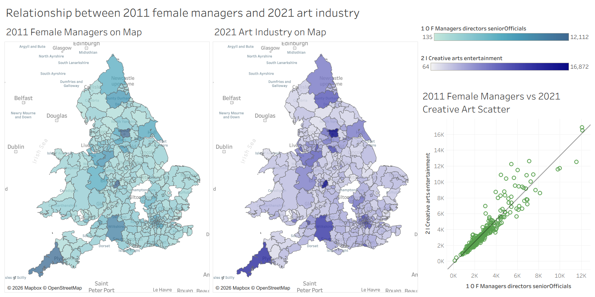
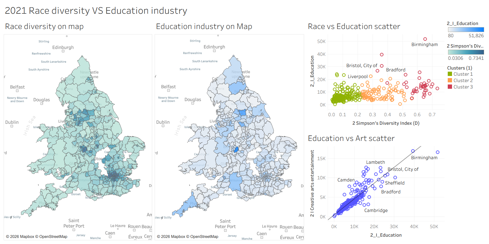

# Version 1 · Original analysis

A Tableau Story exploring how social equality and economic development relate across the local authorities of England & Wales, using the 2011 and 2021 UK Censuses. The workbook is kept as it was built; files were renamed, map labels set to English and notebook comments translated to English.

<!-- TODO: add a Tableau Public link for the version 1 workbook once published
**[▶ Explore the version 1 Tableau Story](https://public.tableau.com/...)** -->

## Question

Are social equality and economic development related across the regions of England & Wales?

- **Equality** is represented by gender equality (2011) and ethnic diversity (2021).
- **Economic development** is represented by the total number of industry jobs, the creative arts industry and the education industry (2021), which together show economic development from different perspectives.

The question builds on economic research. Braunstein et al. (2019) model how gender inequality affects growth, Nguyen (2021) links gender equality to economic complexity, and Clifton (2008) shows that regions benefit from attracting creativity and diverse groups. The aim is to give socio-economic researchers clear visual evidence on these links.

## Data and preparation

- **Sources.** ONS Census tables at local-authority level: 2011 industry and occupation by sex; 2021 industry, occupation and ethnic group.
- **Cleaning.** Long variable names were shortened (`1_` = 2011, `2_` = 2021, `I` = industry, `O` = occupation, `F`/`M` = female/male), column names standardised, and data types and missing values checked.
- **Merging.** All tables were merged on geography code into one dataset (323 local authorities), and 30 columns were selected for Tableau.
- **Geocoding.** UK geocoding files from The Information Lab let Tableau recognise local authorities.
- **Notebook.** [`notebooks/data_preparation_projection.ipynb`](notebooks/data_preparation_projection.ipynb).

## Derived measures

- **Gender comparison as proportions.** Women and men have different workforce totals, so comparing raw numbers of managers would be meaningless. Each gender is instead compared as a proportion of its own total, e.g. female managers ÷ employed women.
- **Ethnic diversity.** Bar charts of ethnic groups show diversity but cannot compare regions precisely, so two indices were calculated. Simpson's index $D = 1 - \sum_i (n_i/N)^2$ is the probability that two randomly chosen residents belong to different groups. The Shannon-Wiener index measures the uncertainty in predicting a resident's group. Simpson's index varies more across regions, which makes differences in colour intensity easier to see on a map, so it was used for the maps.
- **Projection.** All numeric columns were standardised and projected to two dimensions with PCA, which shows the broad structure and main directions of variation, and t-SNE, which preserves local structure and clusters.

## Visual design

- **Paired maps, then charts.** Each insight starts by comparing the colour-intensity patterns of two maps. Bar charts or scatter plots then show the relationship between the variables, because people compare lengths well (Talbot et al., 2014) and spot clusters and trends quickly (Ware, 2012).
- **Decluttered maps.** Map layers keep only county names, water labels and cities, following the principle of visual clarity (Few, 2006).
- **Interactivity.** Filters and highlighting connect the views within each dashboard so users can find specific areas and follow links between charts.
- **Charts tried and dropped.** Bubble charts and treemaps were tested and dropped: they show quantities through size and make little use of geography, so they worked less well than maps.
- **Story.** Eight dashboards were combined into one Tableau Story with seven story points:

| # | Story point caption | Dashboard |
|---|---|---|
| 1 | Start from 2011, different genders' sci-tech proportion… | 2011 different genders' sci-tech proportion on map |
| 2 | For manager occupation, the inequality is evident. | 2011 different genders' managers proportion on map |
| 3 | Now it's 2021. This similarity distribution indicates art industry's importance. | 2021 creative art industry vs industry total |
| 4 | Will education industry help to improve the ethnic group diversities? | 2021 race diversity vs education industry |
| 5 | Will art industry be related to ethnic diversity? | 2021 race diversity vs creative art industry on map |
| 6 | Here's a surprising finding! | Relationship between 2011 female managers and 2021 art industry |
| 7 | The data structures from projection look familiar… | Data projection |

## Findings

1. **Gender in 2011.** In almost all areas, a smaller proportion of women than men work as managers. Eden in the north and Pembrokeshire and Torridge in the west have a more balanced distribution. In several eastern areas (e.g. North Norfolk, South Holland, Boston, East Lindsey) and parts of the Midwest (e.g. Powys, Shropshire, Herefordshire, Ceredigion), the science and technical proportion is higher for women than for men. Eden stands out on both measures.
2. **The creative arts industry and industry diversity.** The 2021 maps of the creative arts industry and the industry total have very similar colour-intensity distributions, and the scatter plot shows a clear linear positive correlation. A region's creative arts industry is closely related to its industry diversity and economic complexity (Dolfman et al., 2007), so it can serve as a lens on a region's industry diversity.
3. **Ethnic diversity, education and the arts.** Cities with well-known universities, such as Manchester, Birmingham, Leeds, Bristol, Southampton, Cardiff and London, have high ethnic diversity. The scatter plot of education industry against ethnic diversity shows three clusters:
   - low diversity and a less developed education industry (e.g. Eden, Amber Valley)
   - high diversity but a less developed education industry (e.g. Peterborough, Bedford)
   - high on both (e.g. Birmingham, Manchester)

   The creative arts industry follows the same clustering, and education and the arts show a clear positive correlation. A region may develop both together because of shared underlying factors.
4. **Headline: 2011 female managers and the 2021 creative arts industry.** The 2011 map of female managers and the 2021 map of the creative arts industry have very similar distributions, and the scatter plot shows a positive correlation. Leeds, Birmingham and Bristol are high on both, and Eden is low on both. This supports the idea that better gender equality increases the accumulation of human capital, which improves a region's capacity for creativity (Nguyen, 2021). How far women are valued in a region is closely related to its creativity and economic complexity. Alternatively, a region with certain conditions, such as higher economic complexity, may promote both at once.
5. **Projection.** PCA separates two broad clusters: one centred on London (and including Manchester), reflecting the greatest population and economic complexity, and one covering the rest of the country. t-SNE keeps more of the original structure: one cluster brings together the diverse, complex areas around London, Birmingham and Manchester, and the other covers areas with simpler population structures.
6. **Bias in the data.** The census ethnic categories are uneven, e.g. "Chinese" is the only East Asian label, and mixed groups are listed for White + another group but not for Asian + Black. Such categories can carry bias into analysis and AI models and reinforce it (West et al., 2019), which affects judgements about diversity.

## Conclusion

Across the 2011 and 2021 censuses, the regions where more women were managers in 2011 are the regions with more creative arts industry in 2021, which indicates that gender equality may play a significant role in fostering economic development. This invites further study of how female managers affect the local creative industries and economic development. An unknown factor may also drive both variables.

## Limitations and future work

- The total number of industry jobs is not an ideal measure of industry diversity; calculated variables would represent it better.
- Indices or statistical methods for industry diversity or economic complexity could be introduced, with the industry total or the creative arts industry as parameters.
- The dashboards would benefit from more descriptive text and task guidance.

## Files

| Path | Contents |
|---|---|
| `tableau/` | Tableau workbook with eight dashboards and the Story |
| `notebooks/data_preparation_projection.ipynb` | Data preparation, merging and PCA / t-SNE projection |
| `images/` | Dashboard screenshots |

## References

- Braunstein, E., Bouhia, R., & Seguino, S. (2019). Social reproduction, gender equality and economic growth. *Cambridge Journal of Economics*.
- Clifton, N. (2008). The "creative class" in the UK: an initial analysis. *Geografiska Annaler: Series B*, 90(1), 63–82.
- Dolfman, M., Holden, R., & Wasser, S. F. (2007). The economic impact of the creative arts industries: New York and Los Angeles. *Monthly Labor Review*, 130(10).
- Few, S. (2006). *Information Dashboard Design: The Effective Visual Communication of Data*. O'Reilly Media.
- Nguyen, C. P. (2021). Gender equality and economic complexity. *Economic Systems*, 45(4), 100921.
- Talbot, J., Setlur, V., & Anand, A. (2014). Four experiments on the perception of bar charts. *IEEE Transactions on Visualization and Computer Graphics*, 20(12), 2152–2160.
- Ware, C. (2012). *Information Visualization: Perception for Design* (3rd ed.). Morgan Kaufmann.
- West, S. M., Whittaker, M., & Crawford, K. (2019). *Discriminating Systems: Gender, Race and Power in AI*. AI Now Institute.
