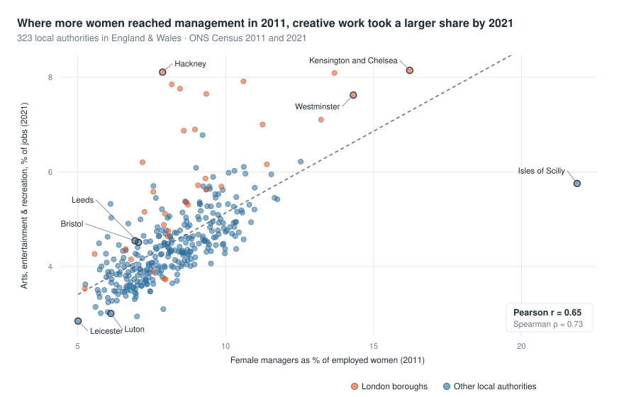
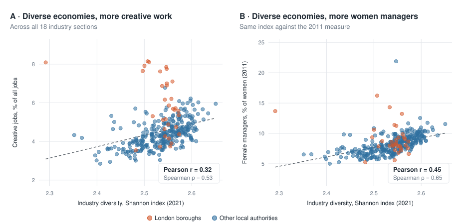
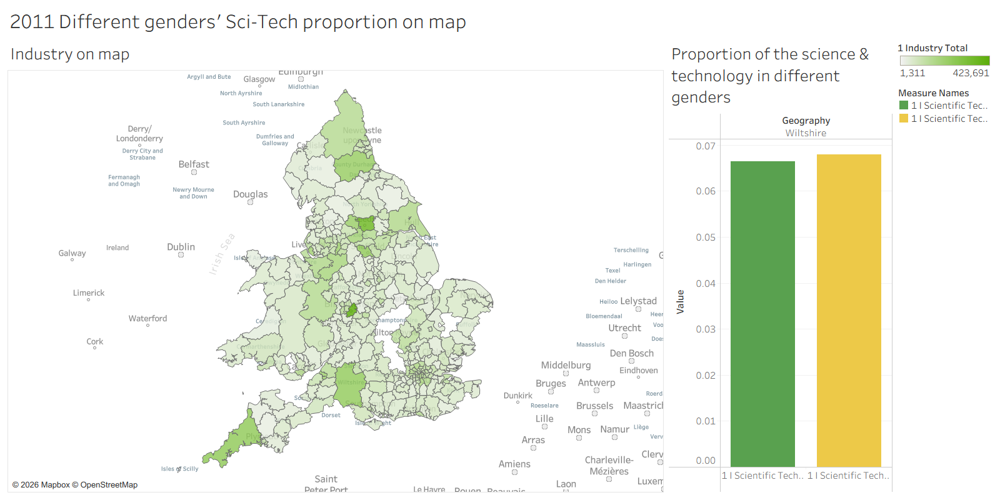
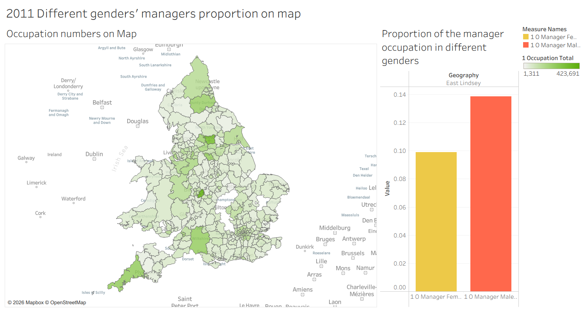
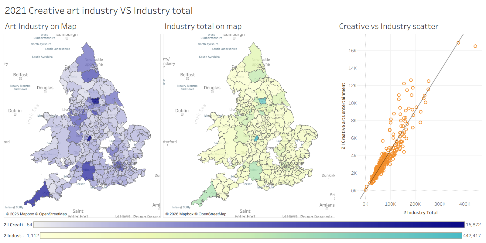
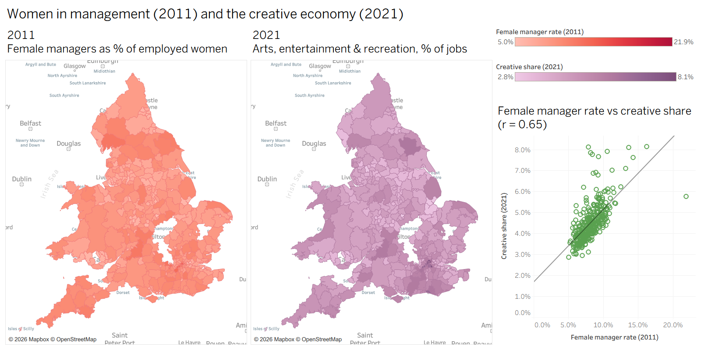
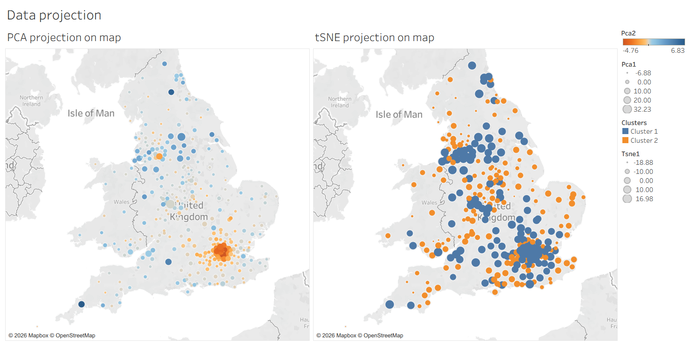

# Version 2 · Revisited analysis

Do places where more women reach management grow more creative economies? This version answers the question for 323 local authorities in England & Wales, with every measure expressed as a **rate or a share**, so that larger areas do not score higher simply because they are larger. How it differs from [version 1](../v1-original/) is set out in the [comparison](../README.md#comparison).



> **Headline finding:** areas where a larger share of working women were managers in 2011 had a larger share of jobs in the creative industries in 2021 (**Pearson r = 0.65, Spearman ρ = 0.73**). The pattern holds outside London (r = 0.69, 290 authorities) and after accounting for men's manager rate (partial r = 0.43). It is a correlation, not evidence of cause.

*"Creative industries" here means census industry section R, **arts, entertainment and recreation**, which also covers sport and leisure.*

<!-- TODO: add a Tableau Public link for the version 2 workbook once published
**[▶ Explore the version 2 Tableau Story](https://public.tableau.com/...)** -->

## Why rates and shares

A count grows with the size of an area: the number of female managers, for example, tracks the total number of jobs almost perfectly (r = 0.92). Any two counts therefore look related, whatever they measure. Every comparison here uses rates or shares instead:

- female managers ÷ employed women
- creative-industry jobs ÷ all jobs

## Key findings

| # | Finding | Evidence |
|---|---------|----------|
| 1 | **Women's career advancement in 2011 relates to the creative economy in 2021.** Areas with a higher proportion of women in management have a larger creative-industry share a decade later. | r = 0.65, ρ = 0.73 |
| 2 | **It is women's advancement specifically, not just more management jobs.** Once women's manager rate is known, men's adds nothing; the reverse is not true. | partial r = 0.43 vs 0.01 |
| 3 | **Diverse local economies have more creative work and more women managers.** A Shannon diversity index across all 18 industry sections rises with both. | ρ = 0.53 and ρ = 0.65 |
| 4 | **The creative share goes with a knowledge-based economy.** It is higher where professional, scientific and technical work is a larger share of jobs, and lower where manufacturing is. | r = 0.73 (outside London 0.54); r = −0.59 (outside London −0.54) |



## Advancement or equality?

| 2011 measure, correlated with creative-industry share (2021) | r |
|---|---|
| Female managers as % of employed women | **0.65** |
| Male managers as % of employed men | 0.55 |
| Women's share of all managers | 0.06 |
| Female ÷ male manager rate (the gender gap) | 0.10 |
| Female rate, controlling for male rate (partial) | **0.43** |
| Male rate, controlling for female rate (partial) | 0.01 |

Male and female manager rates move closely together (r = 0.83), so part of the raw link reflects places with many professional jobs. The partial correlations show that women's advancement carries information beyond that. The measures of gender balance itself, women's share of managers and the gender gap, show little relation to the creative share. The evidence therefore supports "women's career advancement" rather than "gender equality" in a broader sense. None of this establishes causation: a third factor, such as a region's economic structure, may drive both.

## Tableau Story

The version 2 workbook uses rates and shares in the headline dashboard (`SUM(creative jobs) / SUM(all jobs)` and `SUM(female managers) / SUM(employed women)`). Its Story, *Relationships between social equality and economic development*, has five story points. Story points 3 and 5 use counts, as in version 1. The version 1 story points on ethnic diversity, education and the arts are not part of this Story; they remain in [version 1](../v1-original/).

**Story 1:** Start from 2011,  different genders' sci-tech proportion...



**Story 2:** For manager occupation, the inequality is evident.



**Story 3:** Now it's 2021. Research links creativity to growth and economic diversity (Clifton, 2008; Dolfman et al., 2007). The creative art industry and the industry total show similar distributions.



**Story 4:** Where more women reached management in 2011, creative work took a larger share by 2021 (r = 0.65).



**Story 5:** The data structures from projection look familiar...



## Method

- **Data.** 2011 industry and occupation by sex, and 2021 industry, occupation and ethnic group, at local-authority level for England & Wales (see the [data](../data/) folder).
- **Partial correlation** removes the linear effect of one variable (e.g. men's manager rate) before correlating the other two.
- **Industry diversity** uses the Shannon index across the 18 industry sections:

  $$H = -\sum_i p_i \ln p_i$$

  where $p_i$ is the share of local jobs in industry section $i$.
- **Reproducibility.** [`scripts/make_charts.py`](scripts/make_charts.py) recreates every chart on this page and prints every number quoted here, using only the Python standard library:

  ```bash
  python v2-revisited/scripts/make_charts.py
  ```

## Limitations

- **Correlation only.** Areas are compared at one level (local authority) with no causal design. Neighbouring areas are not independent of each other, so the strength of evidence is likely overstated by standard significance tests.
- **Chosen after a first look.** The measures and tests in this version were chosen after version 1's results were known, so they are best read as exploratory.
- **Structure, not development.** No income or output data (e.g. GDHI or GVA) is used; "economy" here means the mix of industries, not prosperity.
- **The 2021 census.** It took place during the COVID-19 pandemic, including the furlough scheme, and ONS advises care when using its labour-market topics, including industry.
- **Boundary changes.** Eight authorities created by reorganisations between 2011 and 2021 (Bournemouth, Christchurch and Poole; Buckinghamshire; Dorset; East Suffolk; North and West Northamptonshire; Somerset West and Taunton; West Suffolk) have no 2011 counterpart and are excluded, leaving 323 of 331.
- **Broad industry category.** Section R includes sport, gambling and recreation as well as the arts.
- **Small areas.** Rates for very small populations are noisy; the Isles of Scilly (about 2,000 residents) is an outlier on the women-in-management axis.
- **Tableau.** Story points 3 and 5 still use counts. The industry diversity index and findings 3–4 appear only on this page, not in the workbook. Two of the 323 areas are not recognised by Tableau's geocoding and do not appear on the maps, though they are included in all numbers.

## Files

| Path | Contents |
|---|---|
| `tableau/` | Version 2 Tableau workbook |
| `scripts/make_charts.py` | Charts and numbers on this page |
| `images/` | Charts and dashboard screenshots |
